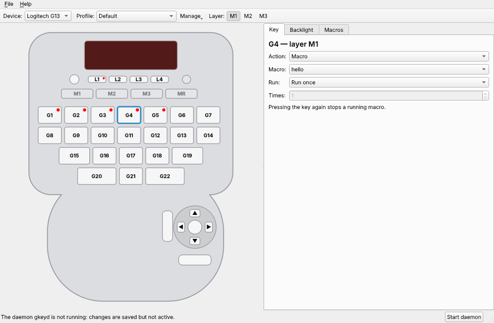

# gkey-config

**Configure the gaming keys of Logitech G keyboards and keypads on Linux**

[Wiki](https://github.com/Lordbooker/gkey-config/wiki) · [Installation](https://github.com/Lordbooker/gkey-config/wiki/Installation) · [Troubleshooting](https://github.com/Lordbooker/gkey-config/wiki/Troubleshooting) · [Contributing](CONTRIBUTING.md)

gkey-config builds on the kernel driver `hid-lg-g15`. A small user daemon takes over the gaming
keys and sends keys, key combinations and macros through a virtual input device; the application
*G-Key Configuration* edits profiles and macros. No extra kernel or USB driver, no input-remapper
or keyd.

## Features

- Keys, key combinations, mouse buttons, macros, layer and profile switches on every G key
- Three layers (M1–M3) per profile, any number of profiles
- Macros with recording, run once, while held, as a toggle or several times
- Backlight colour or brightness per profile
- LCD: flame start animation, profile name on change, status, system load with temperatures,
  CPU (clock of each thread), AMD and NVIDIA GPU (clocks, temperatures, VRAM, power, fan), clock,
  text from scripts
- G13 stick as keys, mouse pointer, scroll wheel or joystick
- D-Bus API for scripts, tray icon, interface in six languages

## Supported devices

| Device | Status |
|---|---|
| [Logitech G13](https://github.com/Lordbooker/gkey-config/wiki/Logitech-G13) | supported (Linux 6.19 or newer) |
| [Logitech G510](https://github.com/Lordbooker/gkey-config/wiki/Logitech-G510) | untested |
| [Logitech G15](https://github.com/Lordbooker/gkey-config/wiki/Logitech-G15) | untested |
| [Logitech G15 v2](https://github.com/Lordbooker/gkey-config/wiki/Logitech-G15-v2) | untested |
| [Logitech G11](https://github.com/Lordbooker/gkey-config/wiki/Logitech-G11) | untested |

Untested devices are described from the kernel driver; there is no test hardware. If you own one,
please [report](https://github.com/Lordbooker/gkey-config/issues) whether it works.

## Installation

| System | Package |
|---|---|
| Arch Linux and derivatives | AUR: [`gkey-config`](https://aur.archlinux.org/packages/gkey-config) |
| Ubuntu 26.04 and derivatives | `.deb` from the [releases](https://github.com/Lordbooker/gkey-config/releases) |
| Fedora 44 | `.rpm` from the [releases](https://github.com/Lordbooker/gkey-config/releases) |
| SteamOS 3.9 or newer (Steam Deck) | archive with install script from the [releases](https://github.com/Lordbooker/gkey-config/releases), [untested](https://github.com/Lordbooker/gkey-config/wiki/Steam-Deck) |

Then open *G-Key Configuration* from the application menu; on its first start it sets up the
daemon autostart and LED access. Details in the
[wiki](https://github.com/Lordbooker/gkey-config/wiki/Installation).

gkey-config replaces [linux-g13-driver](https://github.com/Lordbooker/linux-g13-driver); both
cannot run at the same time.

**Note:** for its key output the daemon needs `/dev/uinput`, which the udev rule opens to the
logged-in user. Every program of that user can then create virtual keyboards and type into any
window – the same access that Steam's controller support requires. Details in the
[wiki](https://github.com/Lordbooker/gkey-config/wiki/Installation#what-gets-installed).

## License

GNU General Public License, version 2 only (GPL-2.0-only) – see [LICENSE](LICENSE).
